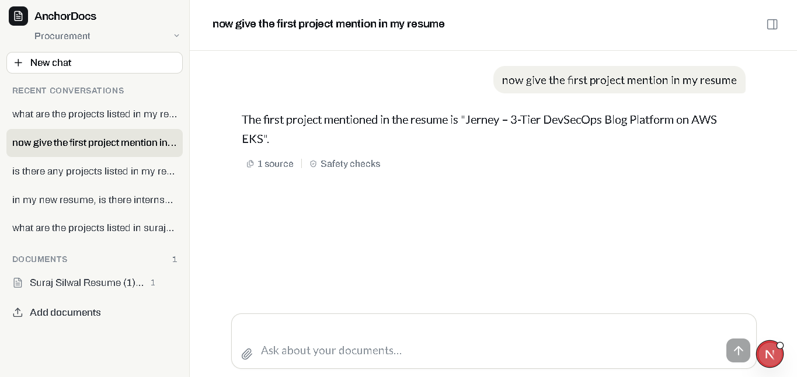
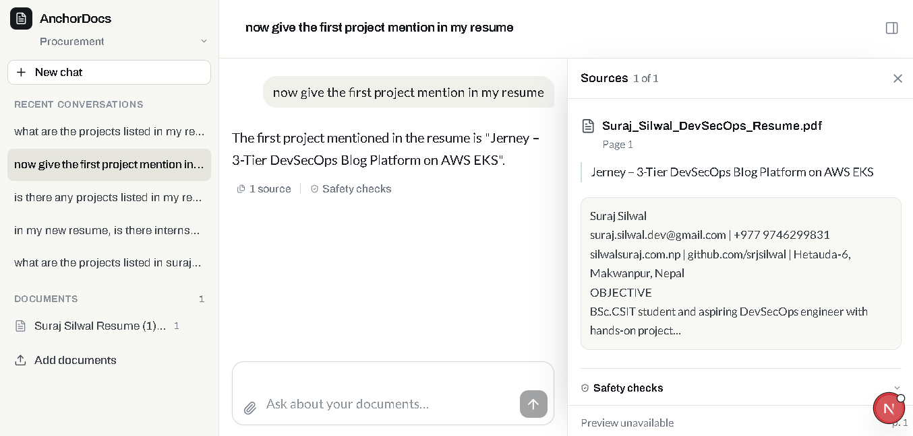
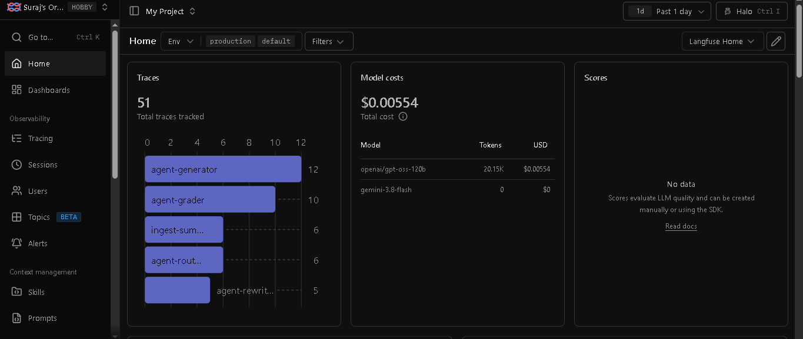

# AnchorDocs

> An AI-assisted document intelligence and safety layer that helps teams understand, review, and trust high-stakes documents before they are shared, approved, or acted upon.

AnchorDocs brings retrieval-grounded AI, policy guardrails, and observable evaluation into one workflow. Instead of asking a general-purpose model to "read this document," users get answers backed by the source, safety checks around sensitive actions, and a review trail that makes the result easier to verify.

## What it is

AnchorDocs is a workspace for working safely with business documents such as contracts, policies, reports, onboarding material, compliance evidence, and internal knowledge bases.

It is designed to:

- ingest and organize documents;
- answer questions using the relevant source passages;
- summarize and extract key obligations, risks, and decisions;
- detect or prevent unsafe, ungrounded, or policy-violating responses; and
- measure the quality of the AI workflow over time.

The central principle is simple: **AI should assist document decisions, but the document and the organization’s rules remain the source of truth.**

## Why it matters

Organizations have a growing volume of documents but limited time to review them carefully. Important knowledge is often fragmented across PDFs, policies, vendor agreements, and shared folders. Traditional search returns files; a generic chatbot may return a confident answer with no reliable evidence.

This creates practical industry problems:

| Industry problem | Consequence | How DocumentGuard addresses it |
| --- | --- | --- |
| Knowledge is buried in long, scattered documents | Slow reviews and missed details | AnchorDocs retrieval finds the most relevant passages before generating an answer. |
| AI can hallucinate or use the wrong source | Bad decisions, compliance exposure | Responses are grounded in retrieved context and presented with citations. |
| Sensitive data can be exposed through prompts or outputs | Privacy and security risk | Guardrails inspect inputs and outputs, apply policies, and block or redact unsafe content. |
| Policies change faster than teams can absorb them | Inconsistent decisions | A shared, queryable document layer keeps guidance accessible and traceable. |
| AI quality is hard to prove | Low trust and difficult governance | Evaluations track correctness, grounding, safety, and latency against repeatable test cases. |

AnchorDocs is especially useful for legal, finance, healthcare, insurance, HR, operations, and regulated SaaS teams—anywhere that documents influence a consequential decision.

## How it works

```text
                         ┌──────────────────────────┐
                         │   Documents / Knowledge   │
                         │ PDFs, policies, reports…  │
                         └─────────────┬────────────┘
                                       │
                              Ingest, parse, chunk
                                       │
                         ┌─────────────▼────────────┐
                         │  Embeddings + Vector Store │
                         │ searchable source chunks   │
                         └─────────────┬────────────┘
                                       │
User question ──► Input guardrail ─► Retrieval ─► Orchestrated AI workflow
      │                 │                 │                  │
      │                 └─ reject/redact  │                  ├─ answer/summarize
      │                                   │                  ├─ cite evidence
      │                                   │                  └─ request review
      │                                   │
      └──────────────────────────────► Output guardrail ─► Safe answer + audit data
                                                               │
                                                         Evals & monitoring
```

### Request lifecycle

1. A user uploads a document or asks a question.
2. The system extracts text, breaks it into meaningful chunks, and indexes those chunks for semantic retrieval.
3. Input guardrails validate the request—for example, checking for prompt injection, disallowed requests, or sensitive data.
4. The retrieval layer selects source passages that best match the question.
5. An orchestrated workflow gives the model the question, approved instructions, and only the retrieved evidence it needs.
6. The answer is checked for safety, policy compliance, and grounding before it is returned with supporting citations.
7. Evaluation and observability capture whether the response was useful, supported, safe, and fast enough.

## Architecture

AnchorDocs separates the user experience, application services, AI orchestration, and data/quality layers. This keeps the safety and governance mechanisms independent from the chat interface.

```text
┌──────────────────────┐
│ Frontend             │
│ Upload • Search • Q&A│
│ Review • Citations   │
└──────────┬───────────┘
           │ HTTPS/API
┌──────────▼───────────┐
│ Application API      │
│ Auth • Documents     │
│ Sessions • Audit     │
└──────────┬───────────┘
           │
     ┌─────┴─────────────────────────────┐
     │ AI service / workflow orchestration│
     │                                   │
     │  ┌─────────────┐  ┌─────────────┐ │
     │  │ Guardrails  │  │ RAG         │ │
     │  │ input/output│  │ retrieve    │ │
     │  └─────────────┘  └──────┬──────┘ │
     │                           │        │
     │                    ┌──────▼──────┐ │
     │                    │ LLM + tools │ │
     │                    └──────┬──────┘ │
     │                           │        │
     │                    ┌──────▼──────┐ │
     │                    │ Evals/traces│ │
     │                    └─────────────┘ │
     └───────────────────────────────────┘
           │                    │
┌──────────▼─────────┐  ┌───────▼───────────┐
│ Document/Object DB │  │ Vector database    │
│ files, metadata    │  │ chunks, embeddings │
└────────────────────┘  └───────────────────┘
```

### Important design properties

- **Grounded by default:** the model answers from retrieved document context rather than relying only on model memory.
- **Human-verifiable:** citations let reviewers inspect the original material behind an answer.
- **Policy-aware:** guardrails apply organizational boundaries before and after generation.
- **Stateful when needed:** multi-step tasks can preserve workflow state, retry safely, and route uncertain cases for review.
- **Measurable:** evaluation datasets and traces make regressions visible before they impact users.

## Core concepts

### RAG — Retrieval-Augmented Generation

RAG combines information retrieval with language generation. A document is converted into searchable chunks; when someone asks a question, the system retrieves the chunks most relevant to it and includes them as evidence for the model.

For AnchorDocs, RAG helps ensure an answer such as “What is the termination notice period?” comes from the actual agreement, not an invented or stale answer. Good RAG depends on clean extraction, sensible chunk sizes, metadata filters, retrieval quality, and citation-aware prompting.

### Guardrails

Guardrails are controls that keep an AI workflow within safe and useful boundaries. They are not one feature; they are layers of protection.

| Layer | Example control |
| --- | --- |
| Input | Detect prompt injection, restrict unsupported requests, redact sensitive identifiers. |
| Retrieval | Enforce document permissions and tenant boundaries; filter untrusted content. |
| Generation | Require source-grounded answers, structured outputs, and uncertainty when evidence is weak. |
| Output | Check for private data leakage, unsafe advice, missing citations, or policy violations. |
| Human review | Escalate ambiguous or high-impact cases instead of silently guessing. |

Guardrails reduce risk; they do not eliminate the need for access controls, strong data handling, and human oversight.

### LangChain

LangChain is an application framework for connecting language models to the components around them: document loaders, text splitters, embedding models, vector stores, retrievers, prompts, tools, and output parsers.

In this kind of system, it provides reusable building blocks for the RAG pipeline so the team can replace a model or vector store without rewriting the entire experience.

### LangGraph

LangGraph is used for stateful, multi-step AI workflows. It models the workflow as a graph: each node does a focused job and edges decide what happens next.

For example, an AnchorDocs graph may validate a question, retrieve evidence, generate a draft, verify grounding, and either return the answer or route it to a retry/review path. This is more reliable than a single, opaque prompt because the decision points are explicit, inspectable, and recoverable.

```text
Validate request → Retrieve sources → Draft answer → Verify evidence
       │                   │                  │              │
       └─ blocked          └─ no results      └──────────────┤
                                                              │
                                               pass → Return cited answer
                                               fail → Refine / ask for review
```

### Evals — AI evaluation

Evals are repeatable tests for AI behavior. Unit tests alone cannot show whether a retrieval answer is accurate, grounded, or safe, so AnchorDocs should maintain a representative set of document questions and expected properties.

Useful evaluation dimensions include:

- **Answer quality:** Does it answer the question correctly and clearly?
- **Groundedness:** Is every important claim supported by the retrieved source?
- **Retrieval quality:** Did the relevant chunk appear in the evidence set?
- **Citation quality:** Are references accurate and useful to a reviewer?
- **Safety:** Does it handle sensitive, adversarial, or out-of-scope requests correctly?
- **Operational quality:** What are the latency, cost, error, and fallback rates?

Run evals whenever prompts, models, chunking, retrieval settings, or guardrails change. Production feedback should become new test cases.

## Screenshots

### Document workspace



The workspace combines recent conversations, uploaded documents, and the document-grounded chat experience.

### Grounded Q&A with citations


Answers include supporting source passages and source citations from the uploaded document.

### Safety or review state



Safety checks appear alongside the generated answer so reviewers can verify that the response passed the configured controls.

### Evaluation and observability dashboard



The dashboard visualizes trace activity, model usage, cost, and observability metrics across the application.

## Getting started

The project is organized with the frontend in `frontend/`. From that directory, install the project dependencies and start the development server using the scripts defined in its `package.json`.

```powershell
cd frontend
npm install
npm run dev
```

Then open the local URL reported by the development server. Refer to `frontend/README.md` for frontend-specific commands and configuration.

### Deployment configuration

The frontend calls the FastAPI service from the browser. Before deploying the frontend (for example, on Vercel), set this Production environment variable and redeploy it:

```text
NEXT_PUBLIC_API_URL=https://your-public-api-domain
```

Use the public HTTPS URL of the deployed backend, without a trailing slash. `localhost` works only on a developer's computer; using it in a deployed frontend makes document loading and uploads target the visitor's own machine. The backend must also be deployed and healthy at `/health`. If its CORS configuration is restricted, set `FRONTEND_URL` on the backend to the exact deployed frontend origin.

## Responsible use

AnchorDocs is a decision-support system, not a replacement for legal, medical, financial, compliance, or security professionals. For high-impact decisions, review the cited source material and retain appropriate human approval steps.

## Roadmap ideas

- Role-based document access and tenant-aware retrieval
- Version-aware citations and document comparison
- Approval workflows for high-risk outputs
- Automated evaluation suites and regression gates
- Audit exports for compliance reviews
- Feedback loops that improve retrieval from verified user outcomes

---

AnchorDocs is built around a simple promise: **faster document intelligence without giving up evidence, safety, or accountability.**
